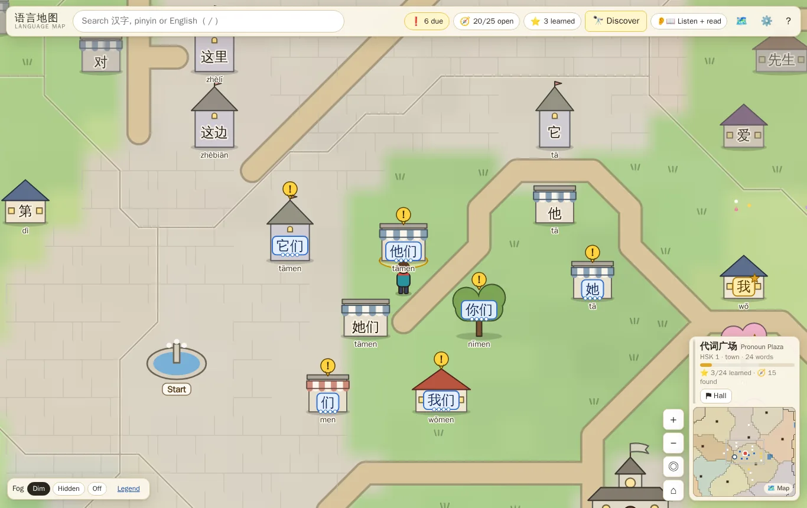
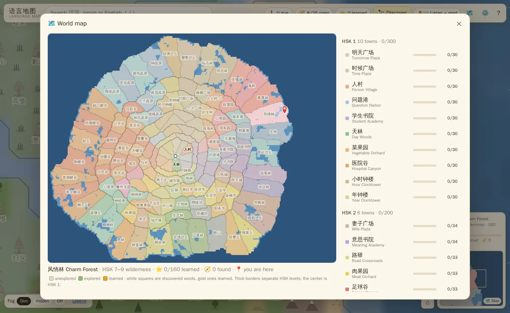
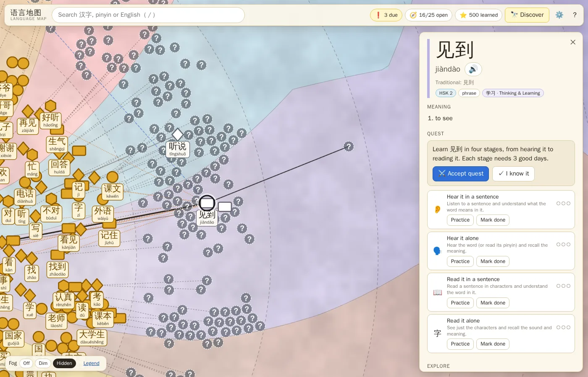

# language-map · 语言地图

A vocabulary world map for language learning, played like a small 2D game. Every word lives in
a landmark (a cottage, a shop, a tree, a mountain, a cloud…) in a town you can walk around, so
where a word sits and which words live next to it hint at what it means. You start at the
fountain in the central plaza and explore outward.

First pack: **Mandarin Chinese → English, HSK 3.0 (official 2025 exam syllabus)**. It has all
11,000 words, HSK 1 to 7–9. The data model and app are language-agnostic.

**Live:** <https://jeffdshen.github.io/language-map/>



## How it works

- **The world.**
  - The map is an island on a grid. HSK 1 surrounds the start plaza, and each band further out
    is the next level.
  - Words live in small **hamlets** of 1–7 related words, with open land, roads and paths in
    between, so a town is something you wander through rather than a packed grid.
  - Each band is split into **towns** of similar size (about 25 words in HSK 1, up to 60 in
    HSK 6). A town gathers words with related meanings and is named for what they share, e.g.
    家人村 *Family Village*, 食物果园 *Food Orchard*, 天气驿 *Weather Crossroads* or
    数字钟楼 *Number Clocktower*. Each town has a **hall**, and roads link the halls.
  - HSK 7–9 is the **wilderness**: bigger, sparser regions of forests, lakes, peaks and dunes.
  - Related words are pulled together (similar meaning, shared characters, "builds on"). Word
    density is even in every town and never gets denser further out.
- **Playing.**
  - You are a small character. Walk with WASD / arrow keys (hold Shift to run), or click or tap
    anywhere to walk there. Walk up to a landmark and press `E` (or click it) to open its word.
  - `N` walks to the next unexplored word nearby. `C` re-centers the camera on you.
  - The camera stays zoomed in on one screen of a town; zoom a little with scroll, pinch or
    `+`/`−`.
  - The minimap (bottom right) shows the town you're in and its progress.
  - Press `M` or click the minimap for the **world map**: every region with learned/explored
    progress, sorted by level.
- **Landmarks** come from the ground they stand on: cottages, shops, barns and towers in towns;
  trees, pines, boulders, mountains, dunes, mesas, crystals, clouds and lily pads in the wilds.
  The word is written on the landmark. Explored words get their pinyin underneath (in
  listening-only mode it's the other way round: pinyin on the landmark, characters underneath).
- **Quick word card.** Opening a word shows a small card with one-tap choices (keys `1`–`4`):
  - a new word: 👁 **Reveal** (shows it and says it) or ✓ **Know it**
  - a word you've seen: ⚔️ **Learn** (start its quests), ✓ Know it, 💬 **Example** (a sentence,
    English on demand), or 📖 **Details**
  - only 📖 Details opens the full page (meanings, quest stages, sentences, characters, related
    words).
- **Halls.** Each town's hall (the flagged building at its center, or ⚑ Hall on the minimap) has
  two modes:
  - ⚔️ **Challenge**: a quick round of 8 of the town's words, multiple choice. Every word you
    get right is marked as known; a miss reveals the word with its meaning and an example, so it
    goes on your map to learn.
  - 🏋️ **Train**: go through the town's due quests one after another.
- **Fog.** Unexplored words are *dimmed* by default: their landmarks and hanzi are faded, so you
  can see the whole world and still tell what you've found. It can be set to *hidden* (only "?"
  spots next to explored words) or *off*. 🔭 Discover picks a good word near you.
- **Quests.**
  - Each word has four stages: **hear it in a sentence → hear it alone → read it in a sentence
    → read it alone**.
  - A stage needs successes on 3 different days (configurable).
  - It's the honor system: listen or read, reveal the answer, then mark ✓ Got it or ✗ Not yet.
    You can mark any stage, or the whole word, as already known.
- **Listening-only mode.** Toggle 👂 *Listening* vs 👂📖 *Listen + read* in the top bar. In
  listening-only mode a word counts as learned after the two listening stages, and all progress
  displays use that; the map labels words by their pinyin (the sound you'd recognize), and hall
  challenges play the word's audio instead of showing the hanzi. Reading practice is still
  recorded.
- **Pacing.** Finishing a stage reveals a nearby or related word, and learning a word reveals
  two, favoring easier levels. A soft cap on open words (25 by default) pauses auto-reveal.
- **Character links.** In the word details, click any character to see every word that uses it:
  where they are on the map, how many you've found and learned in each region, and a sorted list.





Other features:
- Search by 汉字, pinyin (tone marks optional) or English.
- A quest log (`q`) lists what's due today.
- Shortcuts: `/` search, `h` back to the start, `m` world map, `Esc` close; the legend (bottom
  left) lists the rest.
- Bulk "I know everything up to HSK n".
- Progress export/import.
- Works on mobile: tap to walk; the word card, details, quest log and dialogs are bottom sheets
  that close with ×, a tap on the map above them, a swipe down on their grip, or the phone's
  Back button.

Audio uses the browser's built-in speech synthesis (`zh-CN`); if no Chinese voice is installed,
the app tells you to read the pinyin aloud instead.

Progress is stored locally in your browser (IndexedDB, falling back to localStorage). Nothing is
sent anywhere, so use **Settings → Export progress** to back up or move to another device. Tabs
open on the same browser stay in sync. Progress is keyed by the syllabus word ids, not by map
position, so it survives new versions of the site: if an update redraws the map, everything you
found and learned is still there (you'll see a short note once). Saves from the earlier
(2021-list) version are migrated automatically by matching words.

## Run it

Requires Node 22.12+ (CI uses 24).

```sh
cd app
npm install
npm run dev        # http://localhost:5173
```

Other scripts: `npm run build` (static site in `app/dist/`, works from any sub-path),
`npm run preview`, `npm test`, `npm run lint`, `npm run typecheck`.

Every push to `main` deploys the build to GitHub Pages via
[`.github/workflows/pages.yml`](.github/workflows/pages.yml) (repo **Settings → Pages → Source**
must be set to **GitHub Actions**).

## Repository layout

| Path | What |
|---|---|
| `app/` | Vite + React + TypeScript app. `src/map/` is the tile renderer, landmarks, player, camera and minimap, `src/logic/` holds the pure progress, exploration, walking (A*) and hall-challenge logic (unit-tested), `src/ui/` the panels and modals, and `src/store.ts` the app state (zustand). |
| `data/zh-en/` | The committed language pack the app loads: words with grid positions, the world (terrain, roads and regions with their halls), sentences, manifest. |
| `pipeline/` | Offline, deterministic Python pipeline that builds `data/` from pinned sources. See [pipeline/README.md](pipeline/README.md). |
| `docs/design.md` | Design notes and decisions. |

The map is generated **offline** and committed, so everyone gets the same stable world, and
changes show up as reviewable diffs. To rebuild it:

```sh
cd pipeline
uv sync
uv run langmap fetch   # pinned sources, sha256-verified (~1.3 GB, cached)
uv run langmap build   # regenerates ../data/zh-en (byte-identical on re-run)
uv run pytest
```

## Data and licenses

The code is [MIT](LICENSE).

The word list (levels, parts of speech, pinyin, short glosses) is the official 2025 HSK syllabus
via the [HearMandarin HSK 3.0 word list](https://github.com/wzperson/hearmandarin-hsk-3-0-word-list)
(CC BY 4.0). Note that many sites, such as hsk.academy, still show the older HSK 2.0 lists.
Additional English glosses come from CC-CEDICT (CC BY-SA 4.0). Example sentences come from
[Tatoeba](https://tatoeba.org) (CC BY 2.0 FR). Semantic placement uses ConceptNet Numberbatch
(CC BY-SA 4.0). The generated data pack is therefore **CC BY-SA 4.0** (sentences remain CC BY 2.0
FR). Full details are in [ATTRIBUTION.md](ATTRIBUTION.md).
